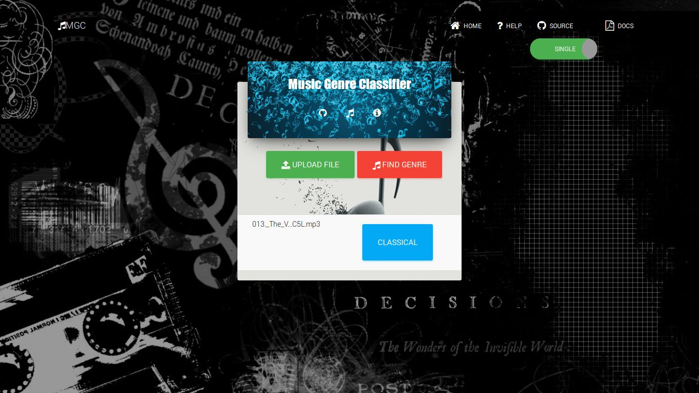
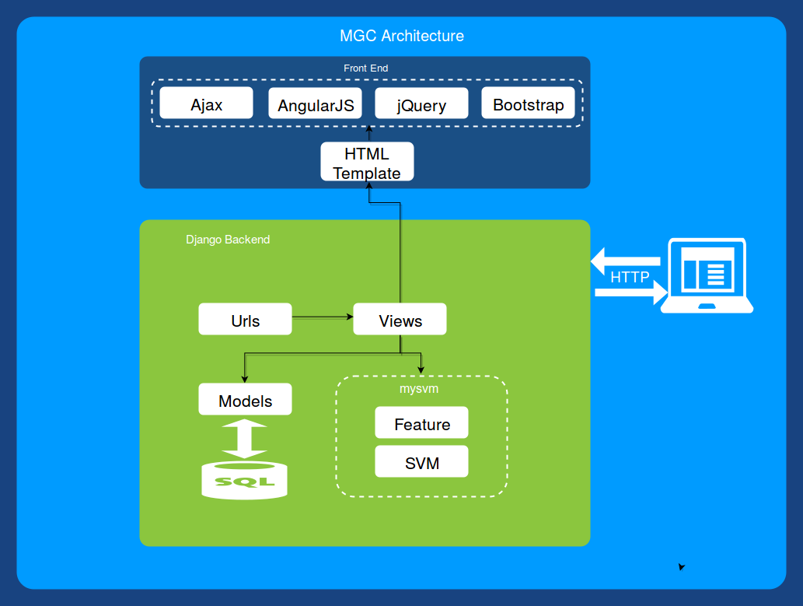
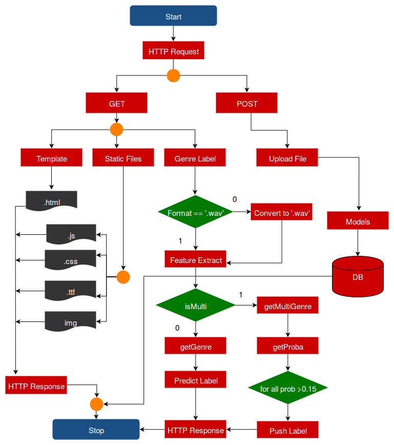

# Music genre classifier — legacy Django demo

An audio-classification example with a Django upload interface and a local
`mysvm` package. The application extracts MFCC-based features, summarizes them
into a fixed-size representation and uses bundled SVM artifacts to predict a
genre or a small set of candidate genres.

This snapshot uses a legacy scientific-Python stack. The documentation and
existing visuals have been reviewed; the application, model artifacts and
historical accuracy claims have not been rerun in a modern environment.

## The existing interface



The included screenshot shows the upload/classify interaction and a single
genre result. It is retained as a historical interface example, not a newly
captured or currently hosted demo. The UI also has a multi-genre path.

| Stage | Relevant code |
| --- | --- |
| Upload and store audio | `fileupload/views.py`, `fileupload/models.py` |
| Decode audio and summarize MFCC features | `mysvm/feature.py` |
| Load the classifier and predict labels | `mysvm/svm.py`, `mysvm/data/` |
| Render upload, help and result views | `fileupload/templates/`, `fileupload/static/` |

The view routes include `/musicUpload/`, `/svm/` and `/multisvm/`. The frontend
uses the saved upload's identifier when asking the backend to classify it.
The classifier module exposes `getGenre`, `getMultiGenre` and `getprob`; its
feature module includes `extract`, `extract_all` and `getlabels`.

## Architecture and processing flow

The repository already contains useful illustrations, so they are reused here:





Feature extraction, dimensionality reduction and classifier experiments are
described further in the included [project report](report.pdf). The bundled
`.pkl` artifacts are loaded by the legacy `joblib` integration at module import;
this documentation pass does not execute or semantically validate those files.

## Reproduction notes

`requirements.txt` records the original dependency set, including Django 1.11,
NumPy 1.12.1 and scikit-learn 0.18.1. These are historical pins, not a supported
installation recipe for current Python. In particular, the code imports
`joblib` through `sklearn.externals`. A dependency/API compatibility pass is
needed before claiming that a modern environment can run it.

The original development sequence, inside a compatible isolated environment, is:

```sh
git clone https://github.com/dev-nezuko/track-genre-tagger.git
cd track-genre-tagger
python -m pip install -r requirements.txt
python manage.py migrate
python manage.py runserver
```

The development server uses port 8000. `manage.py` names the Django settings
package `django-jquery-file-upload`. Compressed audio decoding also depends on
the decoder support available to pydub. Use permitted sample audio; avoid real
user uploads until upload validation, temporary-file handling and deployment
settings have been reviewed.

## What the results do and do not show

The previous README reported roughly 64% test accuracy for a ten-class
polynomial-kernel SVM and 85% for a selected six-class subset. Those are
historical experiment claims, not results reproduced during this update.
Different class subsets and train/test splits are not directly comparable.
No present-day model-quality, latency or production-readiness claim is made.

Before extending the model, establish a reproducible audio dataset/split, record
feature and model versions, and evaluate per-class results. A future UI pass
should make upload/progress/error states clearer and reduce background clutter;
it should only replace the existing screenshots after the actual UI changes.

## Provenance

The original documentation links to
[indrajithi/mgc-django](https://github.com/indrajithi/mgc-django) and its
[MATLAB prototype](https://github.com/indrajithi/music-genre-classification-matlab).
Keep upstream credit separate from any changes to this copy. The existing
[MIT license and notices](LICENSE.txt), project report, images and model files
are retained unchanged.
